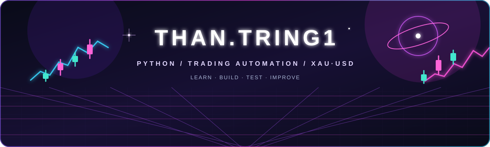
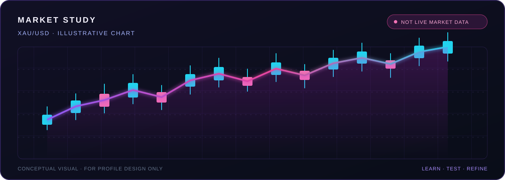

### Building in Python · Exploring trading automation · Learning by doing

---

<table>
  <tr>
    <td width="50%" valign="top">
      <h3>✦ ABOUT</h3>
      
I’m learning by building practical tools with <strong>Python</strong>, with a growing focus on <strong>trading automation</strong> and <strong>XAU/USD</strong> workflows.

      <blockquote>Learn. Build. Test. Improve.</blockquote>
    </td>
    <td width="50%" valign="top">
      <h3>✦ CURRENT FOCUS</h3>
      <ul>
        <li><strong>Python</strong> — fundamentals, scripting, automation</li>
        <li><strong>Markets</strong> — XAU/USD analysis workflows</li>
        <li><strong>Building</strong> — prototyping and refining trading tools</li>
        <li><strong>Process</strong> — testing ideas and learning from each iteration</li>
      </ul>
    </td>
  </tr>
  <tr>
    <td colspan="2" valign="top">
      <h3>✦ MARKET CHART STUDY</h3>
      
A neon candlestick visual for the trading theme. The chart is illustrative and does not show live prices.

      
    </td>
  </tr>
</table>

## ✦ GITHUB STATS

<table>
  <tr>
    <td width="50%" align="center" valign="middle">
      
    </td>
    <td width="50%" align="center" valign="middle">
      
    </td>
  </tr>
</table>

<table>
  <tr>
    <td width="33%" align="center"><strong>LEARN</strong> Keep learning and document the process.</td>
    <td width="33%" align="center"><strong>TEST</strong> Check ideas carefully before relying on them.</td>
    <td width="33%" align="center"><strong>MANAGE RISK</strong> Make risk awareness part of every tool.</td>
  </tr>
</table>

**STAY CURIOUS · FOLLOW THE SIGNAL · KEEP BUILDING**

Personal learning projects. Nothing here is financial advice.

